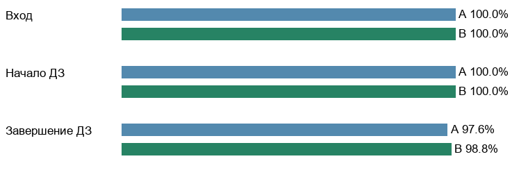

# A/B-тест системы достижений

Сравнение двух интерфейсов образовательной платформы. Учебный проект.



Завершили хотя бы одно ДЗ
A 97.6%     B 98.8%     Разница +1.2 п.п.
95% ДИ [+0.5; +1.9] п.п.   •   p с поправкой 0.00129

Вернулись на 7-й день
A 72.7%     B 78.0%     Разница +5.3 п.п.
95% ДИ [+3.1; +7.5] п.п.   •   p с поправкой 6.4e-06

Вернулись на 14-й день
A 28.8%     B 36.2%     Разница +7.4 п.п.
95% ДИ [+5.1; +9.8] п.п.   •   p с поправкой 2.53e-09

**Решение.** Продолжить проверку перед общим запуском. Добавить событие завершения курса и заранее согласовать минимальный эффект, который оправдает внедрение.

[Анализ и код](analysis.ipynb) · [Презентация](presentation.pptx)

## Запуск

Из корня проекта выполните:

```sh
python -m pip install -r requirements.txt
python -m jupyter lab analysis.ipynb
```

В Jupyter выберите Run All Cells. Исходные таблицы находятся в data/.